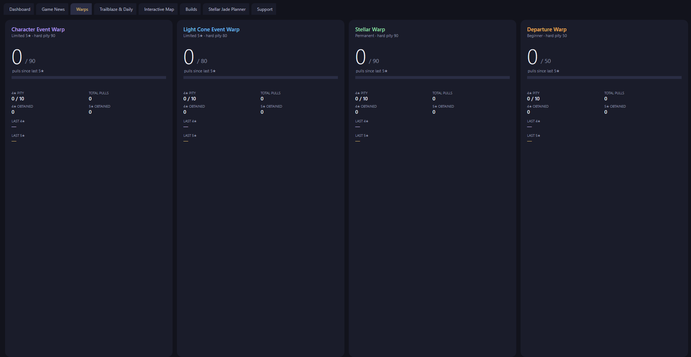
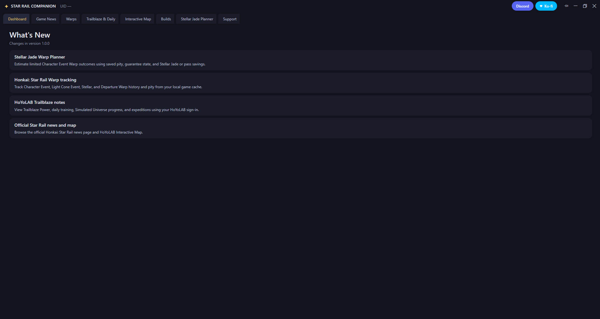
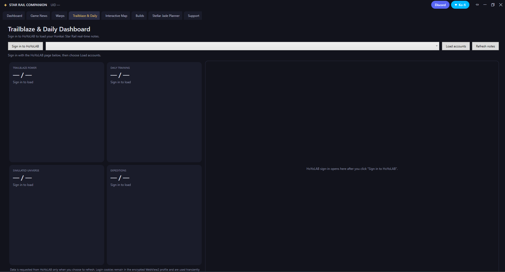
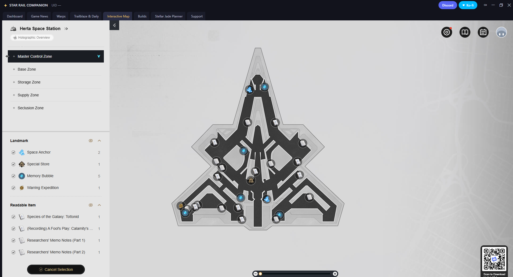
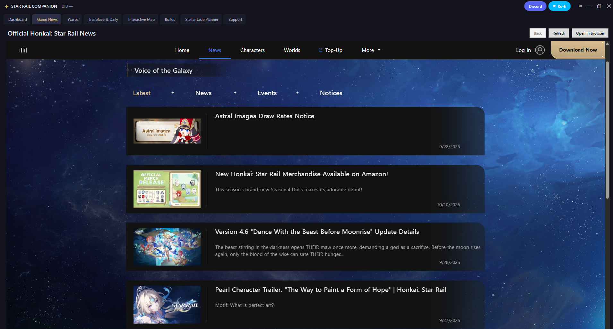
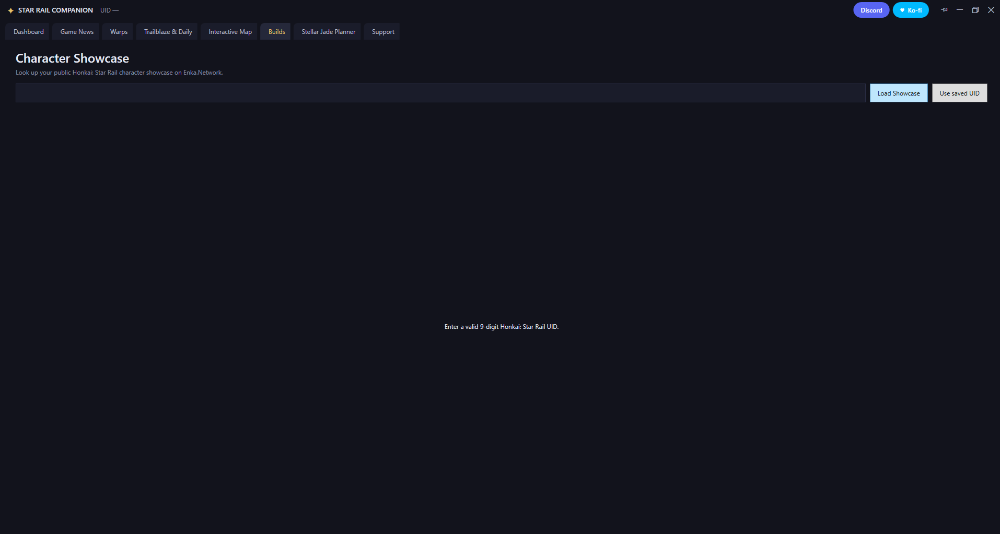

# Star Rail Companion

Star Rail Companion is an unofficial Windows desktop companion for Honkai: Star Rail. It brings Warp pity tracking, a Stellar Jade planner, Trailblaze notes, public character showcases, the official news page, and HoYoLAB's Interactive Map into one resizable window.

## Features

- **Warp tracking:** Sync Character Event, Light Cone Event, Stellar, and Departure Warp history by reading the game's local WebView cache. See pity, 4-star/5-star counts, and recent 4-star/5-star items.
- **Stellar Jade planner:** Estimate the chance of obtaining a featured Character Event 5-star and compare saved Jades and Special Passes with the worst-case guarantee. Pity and guarantee can be filled from saved history.
- **Trailblaze dashboard:** Sign in to HoYoLAB in the embedded browser to view Trailblaze Power, Daily Training, weekly Simulated Universe score, and expeditions.
- **Character showcase:** Open a public Enka.Network Honkai: Star Rail profile by UID.
- **Official pages:** Browse Star Rail news and HoYoLAB's Interactive Map in the app.
- **Privacy-conscious:** No app account or analytics. Warp history, settings, and WebView profiles are stored locally.

This project is community-made and is not affiliated with or endorsed by COGNOSPHERE / HoYoverse. Honkai: Star Rail is a trademark of its respective owner.

## Screenshots

### Warp tracking



### Stellar Jade planner


### Trailblaze dashboard



### Daily training



### Interactive Map



### News



### Builds



## Install

When a release is available, download `StarRailCompanionSetup.exe` from the [latest GitHub Release](https://github.com/greyfoxdevelopment/GFDev-StarRail-Companion/releases/latest). The installer downloads `StarRailCompanion.exe` and its SHA-256 checksum from the same release and verifies the executable before installation.

The installer is self-contained and does not require the .NET runtime. Embedded pages require the Microsoft Edge WebView2 Runtime, which is included with most Windows installations.

## First-time Warp sync

1. Launch Honkai: Star Rail and open **Warp > View Details**. Wait for the history page to load.
2. Open Star Rail Companion and select **Sync Warps**.
3. If the game folder is not detected, use the folder button and select the Star Rail installation folder containing `StarRail_Data`.
4. Warp-history links expire. If sync reports an expired link, reopen **Warp > View Details** in-game and sync again.

Sync reads the game's local cache without modifying it or interacting with the game process. Treat the temporary Warp-history link as private; anyone who has it may be able to access the history while it remains valid.

## Build from source

Requirements: Windows 10/11 x64 and the .NET 8 SDK.

```powershell
dotnet run --project src\StarRailCompanion.csproj -c Release
dotnet build Setup\StarRailCompanionSetup.csproj -c Release
```

See [instructions.txt](instructions.txt) for feature details, troubleshooting, data locations, and release steps.

## Privacy

Data is stored under `%LOCALAPPDATA%\HonkaiStarRailCompanion`. HoYoLAB cookies are kept in the local WebView2 profile and used only for requests you initiate. The app contacts HoYoverse/HoYoLAB for game features, Enka.Network for public profile lookups, the Star Rail Companion release service for release metadata and live notifications, GitHub for update downloads and checksum verification, and Ko-fi when its support tab is opened. The last-seen release sequence is stored locally to catch up on published releases after a missed connection. Each service may process request metadata under its own privacy policy.

The app checks the release service at startup, listens for live release notifications, and retries periodically while running. Update metadata and release notes come from the release service; update executables and SHA-256 checksums are downloaded from GitHub only after confirmation. The checksum detects corruption or mismatch but is not an independent signature against compromise of the release account.

## License

Released under the MIT License; see [LICENSE](LICENSE).
